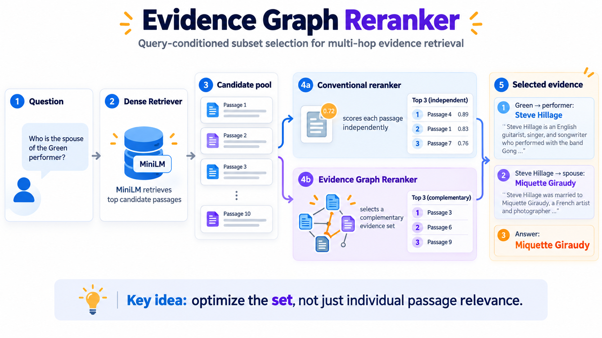
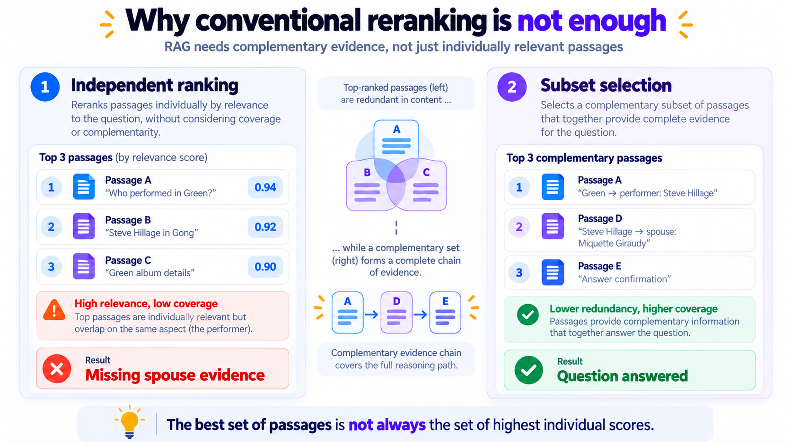
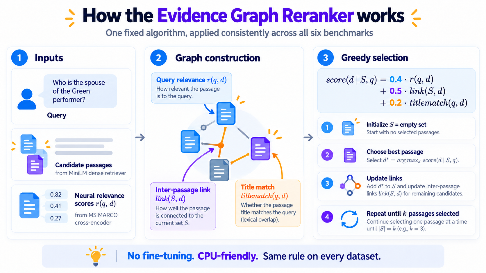
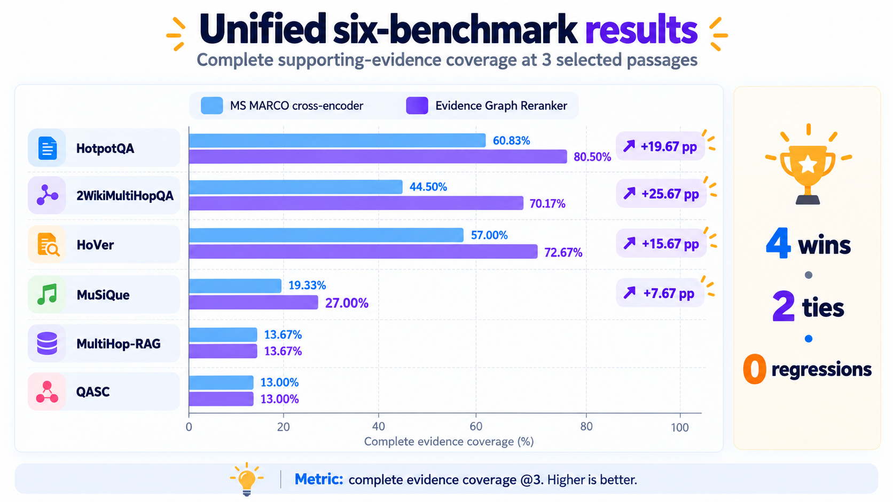
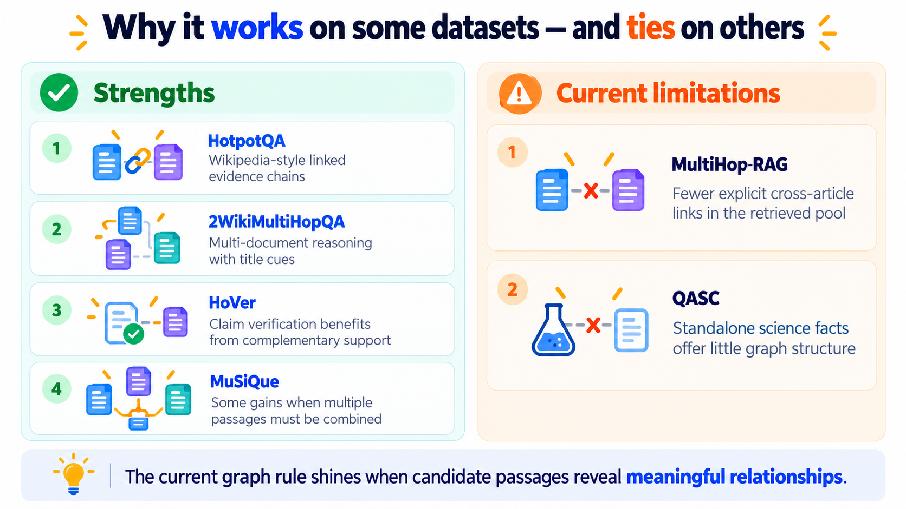
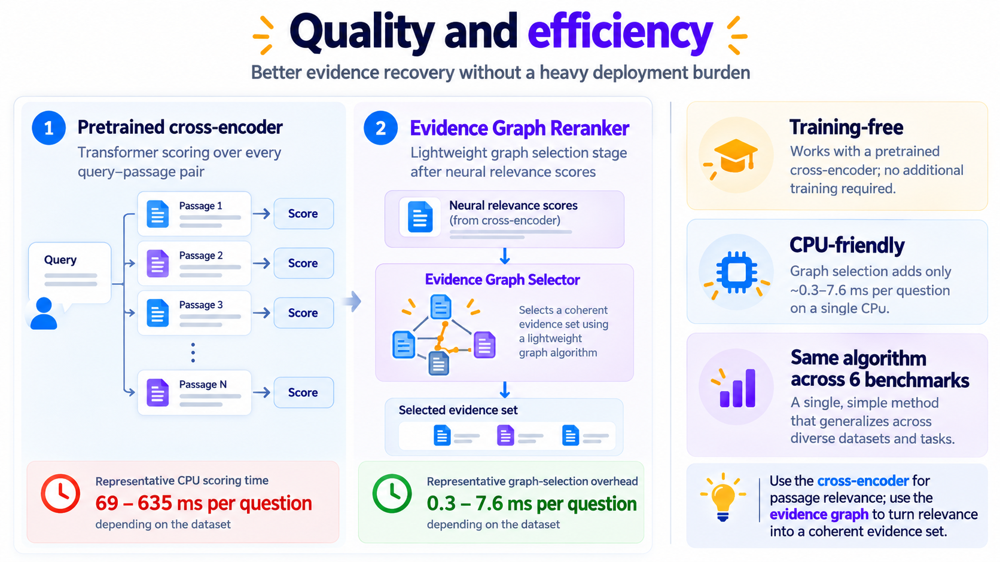

# Evidence Graph Reranker: Stop Ranking Passages. Start Assembling Evidence.

*One fixed, training-free selection rule. Six multi-hop benchmarks. Four improvements, two ties, no regressions at three passages.*

A passage can be highly relevant to a question and still be a poor addition to the evidence a language model receives. That sounds contradictory until you consider a multi-hop question: we need an **entire chain**, not another paragraph that repeats the first step.

Our Evidence Graph Reranker takes the candidate passages from an existing retriever and builds a small, query-conditioned graph from their titles and text. Instead of selecting the highest individual relevance scores, it greedily assembles a complementary set. It uses pretrained neural relevance scores without training a new model.



*Figure 1. The reranker sits **after** an existing retriever and neural scorer. It does not replace either one.*

## The problem: relevance is not the same thing as sufficient evidence

Imagine asking: **Who is the spouse of the musician who performed on *Green*?** One passage identifies the musician; another names the spouse. A conventional reranker may spend its three slots on passages about the album, performer, and band—highly relevant individually, but missing the spouse relationship. A complementary subset must preserve both hops.

The failure mode is not that the neural scorer is wrong. It is that **ranking the elements independently need not yield the best set**. Even a strong pairwise cross-encoder has no explicit representation of which passages were already selected.



*Figure 2. Illustrative evidence chains show why repeatedly choosing individually relevant passages may leave a reasoning hop unsupported.*

## What we built: a graph-aware selector, not another pretrained checkpoint

The released algorithm accepts a query, candidate passages (optionally with titles), and one neural relevance score per passage. For each candidate, it computes three interpretable signals:

1. **Neural relevance.** A pretrained MS MARCO MiniLM cross-encoder, MiniLM dense model, or your existing neural scorer provides a query–passage score. These scores are normalized within the query's candidate pool.
2. **Directed passage link.** If the title of candidate passage B occurs in the body of already selected passage A, that creates an A → B link.
3. **Query–title match.** An exact title mentioned in the query gets the strongest title signal; otherwise partial word overlap provides a smaller one.

At each greedy step, the selector uses one fixed rule:

**Selection score = 0.4 × normalized neural relevance + 0.5 × directed link + 0.2 × query–title match.**

It picks the best remaining passage, adds it to the selected set, and repeats until the desired passage budget is reached. No dataset-specific hyperparameters, no fine-tuning, and no gold-label information is used to select passages.



*Figure 3. The same fixed scoring rule is applied to every evaluated dataset.*

## Six benchmarks, one algorithm

We evaluated **complete supporting-evidence coverage at three selected passages**. A question counts as successful only if **every required annotated supporting passage** appears in the selected set. This is stricter than retrieving just one relevant document, but it is **not** the same as measuring generated-answer accuracy.

| Benchmark | Questions | MS MARCO @3 | MS MARCO + graph @3 | Gain |
|---|---:|---:|---:|---:|
| HotpotQA | 600 | 60.83% | **80.50%** | **+19.67 pp** |
| 2WikiMultiHopQA | 600 | 44.50% | **70.17%** | **+25.67 pp** |
| HoVer | 300 | 57.00% | **72.67%** | **+15.67 pp** |
| MuSiQue | 300 | 19.33% | **27.00%** | **+7.67 pp** |
| MultiHop-RAG | 300 | 13.67% | 13.67% | 0.00 pp |
| QASC | 300 | 13.00% | 13.00% | 0.00 pp |

**Four improvements. Two ties. No regressions at k = 3.** Importantly, these are *six differently constructed benchmark candidate pools*—not one homogeneous end-to-end retrieval leaderboard. The results should be interpreted within each experiment's setting.



*Figure 4. Complete evidence coverage at a three-passage budget, using the pretrained MS MARCO cross-encoder as the common passage scorer.*

The strongest gains come on HotpotQA and 2WikiMultiHopQA, where titles and cross-document references provide useful links. HoVer also improves, but that evaluation uses a **restricted matched subset** whose gold evidence can be located in the available passages. MuSiQue improves more modestly.

For HotpotQA and 2Wiki, the unified algorithm was rerun against **cached genuine neural scores** rather than running the Transformer forward passes again; those previously computed model outputs remain the neural basis for the rerank. The later four experiments also use genuine neural scoring, not TF-IDF.

## The failures are part of the lesson

On **MultiHop-RAG**, the retrieved news articles had few explicit title references across the candidate pool. At three passages, the graph rule tied the cross-encoder; at five passages it showed a small improvement. On **QASC**, the candidates were untitled science facts, so the link and title signals were absent and our algorithm reduced to the original neural ranking.

This is a real limitation, not a footnote to hide. **A title-reference graph cannot manufacture connections that are not explicit in the candidate text.** We intentionally have not inserted semantic-graph features into this release, because that would make it a different algorithm from the one benchmarked.



*Figure 5. The method is particularly helpful in collections with meaningful article titles and explicit inter-document references.*

## Light graph operations, but let's count the full pipeline honestly

After a model has scored the candidate passages, graph construction and greedy selection are inexpensive on a CPU. The recorded graph-stage times range roughly from **0.3 to 7.6 ms/question** across the reported experiments, whereas the separately measured MS MARCO cross-encoder stage took roughly **69–635 ms/question**, depending on the pool and experiment.

That is **not a claim that our full reranker is hundreds of times faster than the cross-encoder**. The graph selector uses neural relevance as input and therefore incurs that scoring cost unless scores are already cached. The CPU timing environments also differ across benchmarks. The real operational advantage is that graph selection adds a relatively small post-processing step to an existing neural scoring pipeline.



*Figure 6. Graph-stage and neural-stage measurements are shown separately; they must not be compared as two complete end-to-end systems.*

## Use it in your own RAG pipeline

The code is available as an installable Python package, a command-line program, and a Gradio demo. The simplest integration requires only your existing relevance scores:

```python
from evidence_graph_reranker import rank_with_scores

selected = rank_with_scores(
    query="Who founded the company that released the Atlas device?",
    passages=[
        {"title": "Atlas device", "text": "Atlas was released by Novus Labs."},
        {"title": "Novus Labs", "text": "Novus Labs was founded by Mira Chen."},
        {"title": "Unrelated", "text": "Another product was launched elsewhere."},
    ],
    scores=[0.9, 0.15, 0.4],
    k=2,
)
print([(item["index"], item["title"]) for item in selected])
```

For neural inference directly, use `EvidenceGraphReranker(backend="cross-encoder")`. This loads the official pretrained MS MARCO MiniLM scorer on first use; the graph selection rule remains the same. The repository has tests, example candidate files, JSON command-line input, and reproducibility records.

Try the public [Hugging Face Space](https://huggingface.co/spaces/Angshul/Evidence-Graph-Reranker) or read [installation instructions](../INSTALL.md). The code does not ship third-party checkpoint weights or datasets.

## The takeaway

**Retrieval supplies candidate facts. Neural reranking scores their relevance. Evidence-graph selection asks whether the selected passages together contain the complete reasoning chain.** Those are different tasks, and treating them as different tasks can produce a substantial improvement without training another model.

The limitations matter just as much: this version exploits explicit title references, some tests are conditional on gold-containing candidate pools, and we have **not measured generated answers or hallucination reduction**. The released six-benchmark evaluation documents those constraints rather than hiding them.

*Project: Evidence Graph Reranker · Author: Angshul Majumdar · Source: [Hugging Face Space](https://huggingface.co/spaces/Angshul/Evidence-Graph-Reranker) · Evaluation details: [results/methodology.md](../results/methodology.md).*
